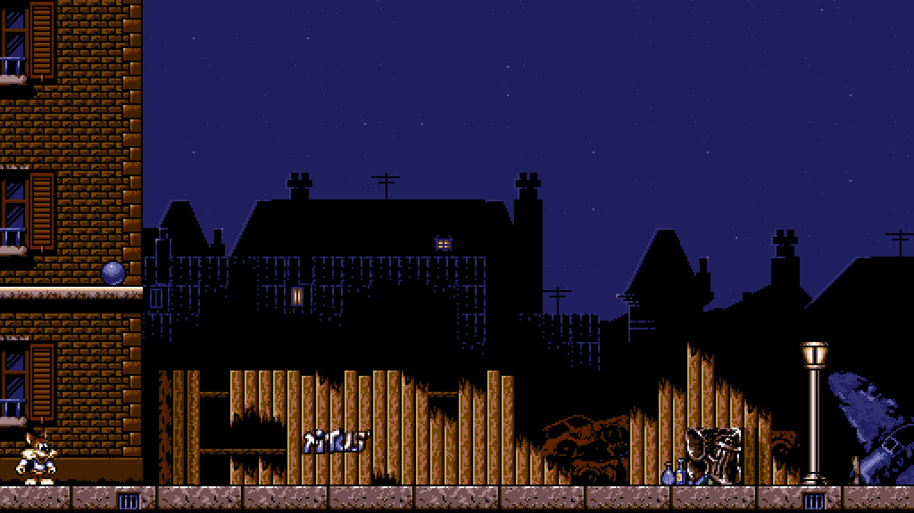
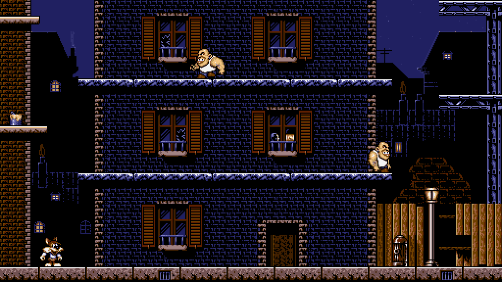
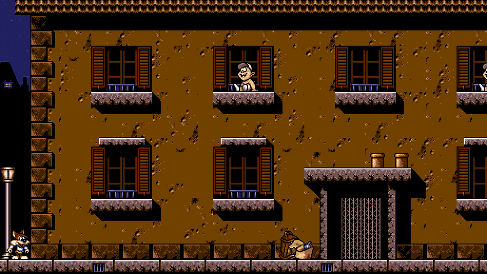
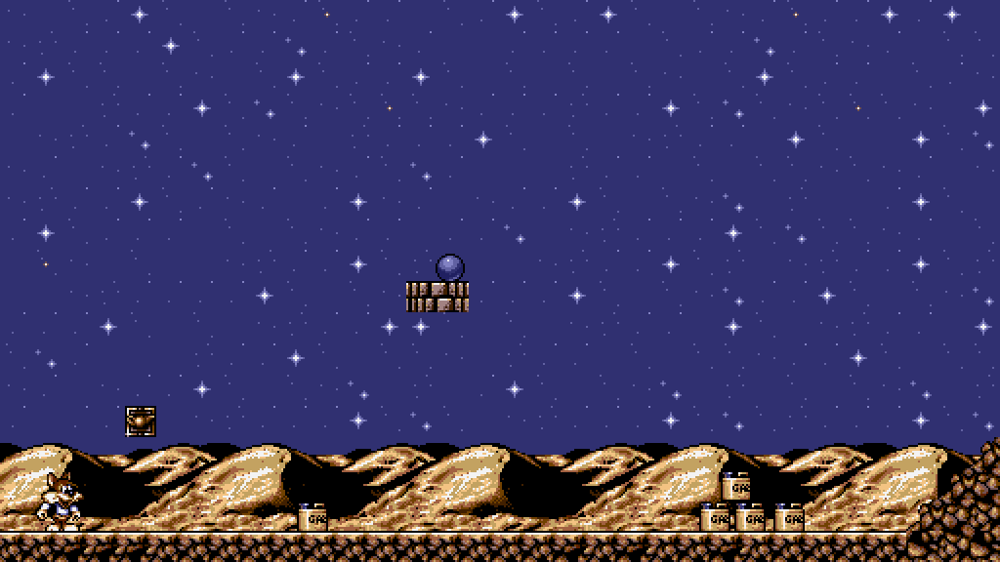

<p align="center"></p>

# FOXRV

A new engine for **Titus the Fox: To Marrakech and Back** (Titus, 1992, DOS), written in C17 with SDL3.

It plays the original levels with the original rules, measured from the game's own code:
- physics, enemies, objects and elevators;
- the camera; 
- AdLib music and sound effects, through an emulated OPL chip;
- or the original's PC speaker music, on an emulated speaker.

It also brings some modern comforts:
- widescreen views (16:9 shows more of the level);
- square, integer-scaled pixels;
- smooth display on high-refresh monitors;
- gamepads;
- optional Scale2x/Scale3x art smoothing.

It also runs on the **Nintendo 3DS** and **2DS**, and on **Android** through the Windows build (see below).

**No game data is included.** You need your own copy of the DOS game.

<p align="center">
  
  
  
  
</p>

## Background

*Titus the Fox* is one of the games I played most as a child. I still remember how hard and unforgiving it was: hours and hours spent retrying levels, and I managed to finish it only once or twice. It was very frustrating, but it also teaches you that winning isn't always easy, and that it takes perseverance and patience to get there. In my opinion it's one of the best games Titus published in the '90s.

FoxRV is not a remake: it tries to mimic the original game's mechanics while adding a few modern comforts, such as a choice of difficulty and gamepad support, so in places it may feel a little different from the original. Feel free to modify it or use it as you like, create new levels, or even make your own mods.

## Game files

Put the original game's files in a folder named `game` next to the executable:

```
FoxRV            (FoxRV.exe on Windows)
engine.ini
game/
    FOX.COM
    FONTS.SQZ  LEVEL*.SQZ  MENU.SQZ  SPREXP.SQZ  TITRE.SQZ  TITUS.SQZ
```

File names are matched ignoring case. Nothing is extracted to disk: the engine decodes the files in memory when it starts and when a level loads. The folder can be changed with `game_dir` in `engine.ini`.

## Building

You need CMake 3.24+, a C17 compiler (GCC or Clang) and git. SDL3 is downloaded and built statically by CMake.

The scripts in the root build in release mode into `build/`; extra arguments go to CMake:

```
build.cmd        Windows: MinGW-w64 GCC from MSYS2 (C:\msys64 is found even if not on PATH)
./build.sh       Linux: the packages SDL3 needs are listed at the top of the script
```

Or by hand:

```
cmake -S . -B build -DCMAKE_BUILD_TYPE=Release
cmake --build build -j
```

The Windows build is a single `FoxRV.exe` that needs no DLLs besides Windows' own.

Both scripts also pack a release zip, `build/FoxRV-<version>-linux-<arch>.zip` or `build\FoxRV-<version>-windows-<arch>.zip`: the program, `engine.ini` and an empty `game` folder. Pushing a tag such as `v0.1.0` makes GitHub build both zips (Linux on Debian 12, so it runs on older distributions too) and publish them under Releases (`.github/workflows/release.yml`).

If `-DFOXRV_GAME_SOURCE=/path/to/your/game` is given, every build copies that folder to `build/game`. By default it is `TTF/` in the source tree. The game files are git-ignored.

## Running

```
build/FoxRV              intro, then the main menu
build/FoxRV 5            straight into level 5 (play order 1-15)
build/FoxRV --selftest   headless checks of the physics against the original's values
build/FoxRV --debug      print the engine's log (with any of the above)
```

The game prints nothing unless `--debug` is given. On Windows it is a GUI program with no console window; `--debug`, `--selftest`, `--dump-opl` and `--dump-pcspk` print to the terminal they were started from, or open a console if there is none. PowerShell doesn't wait for GUI programs, so to wait for the result and get the exit code, pipe the output: `build/FoxRV --selftest | Out-Host`.

Settings live in `engine.ini`: video, audio, controls, camera, difficulty and the original's physics constants. Every key is optional. `view_size = 320x200` in `[video]` shows exactly the original screen, scaled up and centred, instead of a view that grows with the window; in Options it's *Screen*: *Original* or *Wide*.

`device` in `[audio]` picks the sound: `adlib` (the default) or `speaker`, the PC speaker's square-wave music. The original played no effects on the speaker; FoxRV adds short beeps, which silence the music while they play, as on a one-voice speaker.

The frame rate follows the display (`vsync = 1`). Where the driver ignores vsync, as with Wine on Android (Winlator), the game notices within a second and caps itself at the display's refresh rate; `max_fps` sets a lower cap, e.g. 30 to save battery. The game itself always runs at its original speed.

Gamepads (Xbox layout) by default: the D-pad or left stick moves and climbs, A jumps, B picks up and throws, Start pauses, Back opens the menu. Unlike the keyboard's Up, which jumps as in 1991, up on a pad doesn't jump (a worn stick or D-pad would trigger it by mistake), except to grab a ladder above; `pad_up_jumps = 1` in `[input]` makes it jump too. For worn controllers that slip into up, `pad_up_threshold` (how far the stick must be pushed up, 75% by default) and `pad_up_delay` (how long up must be held, 3 game frames, about 80 ms) can be raised, also in Options.

**Options** on the main menu sets the difficulty, the sound device and the screen size, and maps a controller: *Map controller* asks for each action in turn (press a button, or push a stick or trigger; Esc, or holding Back for a second, cancels), and *Reset controller* restores the default layout. Both are saved to `engine.ini`. The keyboard layout is fixed there and only shown. `fullscreen = 1` in `[video]` starts in full screen; F11 or Alt+Enter switch at any time.

## Nintendo 3DS and 2DS

The 3DS build also plays on the 2DS: everything below applies to both. It fills the 400x240 top screen with more of the level than the original's 320x200 (Options > *Screen* > *Original* shows just that, centred), with PC speaker sound (the AdLib emulator is too slow for the 3DS). The bottom screen stays black.

**Building** needs [devkitPro](https://devkitpro.org/wiki/Getting_Started) with the 3DS tools (on Windows, its installer with *3DS Development*). Its toolchain only runs from devkitPro's MSYS2 shell, so:

```
build-3ds.cmd    Windows: runs build-3ds.sh in devkitPro's MSYS2 (C:\devkitPro\msys2)
./build-3ds.sh   in devkitPro's MSYS2 shell, or on Linux / macOS with DEVKITPRO set
```

Both make `build-3ds/FoxRV.3dsx`.

**Installing**, on the SD card:

```
/3ds/FoxRV.3dsx
/3ds/foxrv/game/       FOX.COM and the .SQZ files, as above
```

Start it from the Homebrew Launcher. On first run the default settings are copied to `/3ds/foxrv/engine.ini`, where Options saves its changes.

**Controls:** the D-pad or Circle Pad moves and climbs, B jumps, A picks up and throws, Start pauses, Select opens the menu and goes back in menus. Options' *Map controller* changes them; hold Select to cancel it.

## Android

The Windows build, `FoxRV.exe`, plays on Android phones and tablets in a Windows emulator app: [Winlator](https://github.com/brunodev85/winlator), GameNative or GameHub. Copy `FoxRV.exe`, `engine.ini` and the `game` folder together into a folder the app can see, and start `FoxRV.exe` from it. Where the app ignores vsync, the game caps its own frame rate (see *Running*); `max_fps = 30` saves battery.

## Repository

| Path | Contents |
|---|---|
| `src/` | The engine |
| `src/core/fox_ds.h` | Where the game's tables are in FOX.COM's data segment |
| `documentation/OVERVIEW.md` | How the original's files and code work |
| `tools/` | Optional Python research tools that export the game's data as PNG, JSON, WAV and DRO files. Not needed to build or play. |
| `res/` | The FoxRV icon, original pixel art drawn by `tools/make_icon.py` (which also writes `src/platform/icon_pixels.h` and the 3DS icon) |
| `res/3ds/` | The 3DS build's icon and the default `engine.ini` built into it |
| `res/screenshots/` | The screenshots above, taken with `--shot` |
| `third_party/` | Nuked-OPL3, with its license |

## Thanks

- **[SDL3](https://www.libsdl.org/)** by Sam Lantinga and the SDL contributors, for the window, graphics, sound and gamepads on every platform FoxRV runs on (zlib license).
- **[Nuked-OPL3](https://github.com/nukeykt/Nuked-OPL3)** by Nuke.YKT, the highly accurate OPL3 (Yamaha YMF262) emulator that plays the AdLib music and effects as the real chip did (LGPL 2.1).

## License

FoxRV's code is licensed under the [GNU GPL v3](LICENSE). Nuked-OPL3 in `third_party/` keeps its own license (LGPL 2.1).

FoxRV is an unofficial fan project, not affiliated with or endorsed by Titus or its successors. *Titus the Fox* and its art, music and levels belong to their rights holders; the screenshots show that art only to illustrate the engine.
